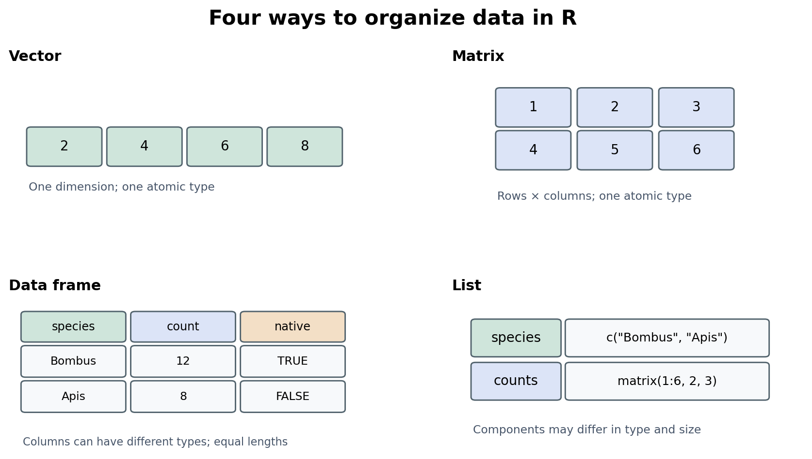

# Key Programming Concepts

## Lecture summary

This chapter builds a foundation for writing clear, reliable R code you can reuse across labs and projects. In lab we will practice these skills and discuss the weekly reading, Alston and Rick (2020), *A Beginner's Guide to Conducting Reproducible Research* [@AlstonRick2020].

###  Learning objectives

By the end of this chapter, you will be able to:

- Distinguish **objects**, **functions**, and **expressions** in R, and use assignment idioms confidently.
- Work with core **data structures** (vectors, matrices/arrays, lists, and data frames) and explain when to use each.
- Use **control flow** (`if`, `for`) and the **apply** family to write clear, vectorized code.
- Write and call **functions** with arguments and return values; document intent with informative names.
- Perform basic **Boolean logic** and use logical indexing for subsetting.
- Read R help, search effectively, and follow reproducible coding practices you’ll build on all term.

###  Why programming concepts matter

Across languages, programming is built from a small set of ideas that you will reuse constantly. Greg Wilson and Software Carpentry organized these ideas into a helpful list of seven [@SoftwareCarpentry2012]: 

1.  Individual things (the number 2, the character 'hello')
2.  Commands that operate on things (the + symbol, the `length` function)
3.  Groups of things (R vectors, matrices, lists, dataframes, and arrays)
4.  Ways to repeat yourself (for and while loops, apply functions)
5.  Ways to make choices (if and try statements)
6.  Ways to create chunks (functions, objects/classes, and packages)
7.  Ways to combine chunks (piping) 

In this course we focus on doing these in **R** for ecological and conservation data. The seven ideas are not seven separate skills: they fit together. For example, we store population sizes in a vector (a group), update them with a formula (a command), repeat the update in a loop, and use an `if` statement to respond to a disturbance.

###  Objects and basic types

In R, values are represented as **objects**. When you assign an object at the console, it generally appears in the Global Environment; inside a function, objects can instead exist only in that function's local environment. An object's **type** describes how its values are stored (`typeof()`), while its **class** (`class()`) helps determine how some functions behave. For simple vectors these often look similar, but they are not always the same.

Common atomic types include **double** (what R usually reports as `numeric`), **integer**, **character**, and **logical** (`TRUE`/`FALSE`). For example, `2` is stored as a double by default, while `2L` is an integer. Numeric doubles have finite precision (typically about 15–16 significant decimal digits); text is stored as character strings such as `"hello world"`. The values `NA` (missing) and `NULL` (absent or empty) are also useful to recognize.

```{r unit1-types-example}
bee_count <- 12L
site <- "meadow A"
observed <- TRUE
class(bee_count)
typeof(bee_count)
class(site)
class(observed)
```


###  Assignments vs. expressions

An **expression** is code that R evaluates, often producing a value: `24 * 7` produces `168`. An **assignment** stores a value under a name: `hours_per_wk <- 24 * 7`. Read `<-` as “assign the result on the right to the name on the left,” not as an equation that R is solving. R evaluates many kinds of code—including assignments and control-flow constructs—as expressions, so the distinction between expressions and statements is not as strict as in some other languages.

```{r unit1-assignment-example}
hours_per_wk <- 24 * 7
hours_per_wk
hours_per_wk / 7  # Using the object does not change its stored value
```


###  Functions and operators

A **function** is a reusable action you call by name, like `max(15, 27)`. The values supplied inside the parentheses are **arguments**. A function evaluates its instructions and **returns** a value; for example, `mean(c(10, 20, 30))` returns `20`. Many mathematical symbols are functions in disguise (operators): `x + y` uses the `+` function. You can also write your own functions to package a calculation that you need to repeat for several species, sites, or scenarios.

A useful habit is to ask three questions whenever you encounter an unfamiliar function: *What input does it expect? What output will it return? What assumptions does it make?* Use `?mean` or `help(mean)` to inspect the documentation.


###  Core data structures

You will manipulate collections of values constantly:

- **Vector**: a one-dimensional collection of values of one atomic type. Arithmetic is often *vectorized*: an operation such as `c(2, 3, 4) * 2` works element-by-element. If you combine characters and numbers in an atomic vector, R converts them to a common type.
- **Matrix**: a two-dimensional array (rows × columns) of one atomic type. For example, a plant–pollinator interaction matrix can hold counts of visits.
- **Array**: an extension of a matrix to three or more dimensions, for example, species × sites × years.
- **Data frame**: a table with equally long columns that may have different types. Typically, each row is an observation and each column is a variable. A bee survey might have character species names, numeric body sizes, and logical native/non-native indicators.
- **List**: a collection whose components may have different types **and** sizes. A list can contain a vector, a matrix, and an entire data frame. A data frame is a special kind of list with equally long columns.

{width=95%}

In R, **indexing starts at 1**, not 0. Use `x[1]` for the first element and `x[length(x)]` for the last. The notation `x[0]` returns an empty vector, **not** the first element. This distinction matters in the population-modeling lab.

###  Comparisons and boolean logic

Comparisons produce **logical** values: `TRUE` or `FALSE`. Operators include `>`, `>=`, `==` (equal), and `!=` (not equal); combine element-by-element comparisons with `&` (and) or `|` (or). Use `!` to negate a condition. Do not confuse `=` or `<-` (assignment) with `==` (testing equality).

Logical vectors are powerful because they can select observations. For example, if `counts <- c(10, 75, 43, 90)`, then `counts > 50` identifies which values exceed 50 and `counts[counts > 50]` returns only those values. `sum(counts > 50)` counts the matching observations because `TRUE` contributes 1 and `FALSE` contributes 0. A comparison involving missing data (`NA`) can itself produce `NA`, so a missing value is not automatically the same as `FALSE`. 


###  Control flow: `if` and `for`

Control statements direct the path of your code. Use `if (...) { ... } else { ... }` when one **TRUE/FALSE condition** determines which instructions to run, and `for (name in collection) { ... }` to repeat instructions across a collection. For example, the lab will use a loop for successive time steps and an `if` statement to determine whether a catastrophe resets the population.

A loop changes what is done on each pass; it does not automatically store the results. We often **pre-allocate** a vector such as `n <- numeric(100)` and then fill its entries so every time step is retained. Indentation is not required by R, but consistently indenting code inside braces makes the logic much easier to read. 


###  The *apply* family (vectorized repetition)

Many tasks that could be written with `for` loops can also be expressed using the *apply* family: `apply()` works across rows or columns of matrices/arrays, `lapply()` returns a list, `sapply()` attempts to simplify that result, and `mapply()` works across multiple inputs. They accept a `FUN` argument specifying which function to apply. Parallel variants such as `parallel::mclapply()` exist, but we will not need them in this unit.

For example, `apply(matrix(1:6, nrow = 2), 2, sum)` calculates a sum for each column (`2` means columns; `1` means rows). The *apply* functions are convenient ways to **repeat** a calculation, but they are not automatically faster than a well-written loop and are not the same concept as vectorized arithmetic. 


###  Writing your own functions

Encapsulate a task by defining a function:

```r
spread <- function(values) {
  out <- max(values) - min(values)
  return(out)
}
```

Well-named functions make analysis pipelines clearer, easier to test, and reusable. Here `values` is the argument, `out` is an intermediate object that exists inside the function, and `return(out)` specifies the result. A function can also accept **default values** (e.g., `p = 0.1`), which callers can override when exploring different assumptions. Test a new function with a simple input for which you can predict the result. 


###  Combining steps with pipes

Pipes let you express “do X, then Y, then Z” by chaining operations. We will use `%>%` from **magrittr/tidyverse**; base R also offers `|>`. Both pass a result forward so a multi-step analysis can be read in order. You’ll see more next week when we start building data-wrangling workflows [@Wickham2023R4DS]. 


###  R vs. Python: a quick orientation

R emerged from statistics; Python from computer science. Both are open-source and widely used in data work. We’ll use R throughout this course, but the concepts above transfer between languages. 

One difference for Python users: R commonly calls functions using `function(data)`, including **generic functions** such as `plot(data)` that can dispatch different methods based on the object's class. Python often uses `data.plot()` for methods. The ecological calculations are conceptually the same; the syntax and object systems differ.

```{r child="demos/01-demo-fundamentals.Rmd", echo=FALSE, error=TRUE}
```

```{r child="demos/02-demo-exponential-growth.Rmd", echo=FALSE, error=TRUE}
```

```{r child="readings/02-reading.Rmd", echo=FALSE, error=TRUE}
```

```{r child="labs/02-lab_populations_student.Rmd", echo=FALSE, error=TRUE}
```